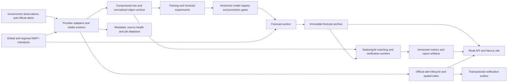

# Product and global architecture

## Product contract

Lilith accepts any terrestrial coordinate and distinguishes **forecast availability**, **observation availability**, **validation coverage**, and **official alert coverage**. These are different capabilities. A global NWP grid can cover a coordinate where no station exists; that location cannot honestly receive a station-verified accuracy score.

The system must show useful global forecasts from verified public reference models while Lilith candidates train and improve. Every value states its source. Model promotion never silently replaces a reference product merely because weights exist.

### Forecast products

| Horizon | Presentation | Data/model requirement |
|---|---|---|
| Current and next 0–72 hours | Observed timestamped conditions plus separate hourly forecast, temperature, apparent temperature, dew point/RH, wind/gusts, precipitation and type, pressure, cloud cover, visibility where available | Station/radar/satellite observations and regional/global NWP; variable-specific availability |
| Days 1–14 | Daily highs/lows, precipitation amounts and calibrated occurrence probabilities, wind/gust outlooks, uncertainty; expand hourly only where supported | Global NWP ensembles, bias correction and independently verified Lilith residuals |
| Days 15–42 | Weekly temperature anomalies, precipitation anomalies/tercile probabilities, broad risk windows | Subseasonal ensembles, climate indices, ocean/land state, rolling hindcasts |
| Days 43–90 | Monthly/seasonal anomaly distributions and probabilities | Seasonal models, historical normals and calibrated subseasonal/seasonal candidates |
| Beyond 90 days | Historical context/climate products only unless separately evaluated | No precise day/location storm forecasts implied by seasonal signals |

The existing 90 daily outputs remain archived research outputs. Displaying precise daily temperatures or storm dates at that range requires demonstrated skill; the intended public site uses broader aggregates. NOAA’s [seasonal product](https://www.cpc.ncep.noaa.gov/pacdir/NFORdir/HOME3.shtml) likewise describes seasonal quantities with probabilistic uncertainty.

## Required site views

1. **Global forecast home:** map/search/geolocation, saved places, local timezone and unit controls, issue/valid times, source/fallback badge, freshness, forecast products by horizon. Distinguish observed current conditions from forecast conditions. State unavailable per variable. Keyboard navigation, screen-reader descriptions, color-independent alert severity, reduced-motion mode, mobile and low-bandwidth layouts.
2. **Location detail:** temperature/precipitation/wind plots, calibrated intervals when available, raw/reference/blend comparison, nearest matched stations with distance/elevation and last observation, source licenses, forecast-run permalink and data export.
3. **Official alerts:** location-aware feed and map layers, issuing authority, event, severity, urgency, certainty, onset/expiry, affected areas, official instructions and source link. Preserve language alternatives. Show provider coverage and feed health; an unavailable feed is not “no alerts.”
4. **Lilith risk outlook:** a separate research/validated-model product for threshold/event probabilities, explicit time/spatial windows, evidence and calibration. Never misattribute a Lilith-generated message to a government authority. No active danger badge based solely on a 90-day seasonal anomaly.
5. **Forecast archive / replay:** browse immutable issuances by location, issue time, model and horizon; overlay later observed records without changing the original prediction; show corrected observation versions and pending comparisons.
6. **Accuracy explorer:** world map of supported station/grid cohorts, per-location/per-region/per-season/per-lead metrics, sample sizes, uncertainty, coverage and baseline skill. “Insufficient evidence” where needed. Filters and exported reports retain cohort definitions and model hashes.
7. **Historical climate / records:** actual station/gridded records with distinct provenance, full available history including pre-1980 data, missingness and station changes; empirical normals with reference period; extrema only over the selected station/period. The initial historical page supports direct global GHCN station IDs; geographic station discovery remains work.
8. **Reports library:** daily operational, weekly model, monthly global/regional, severe-event case-study and training reports; immutable report versions and input manifests.
9. **Data health / coverage:** provider status, ingest lag, age, missing variables, station density, official-alert coverage and last completed verification. Avoid a single green “worldwide” indicator hiding empty areas.
10. **Subscription/preferences:** opt-in channels, places/polygons, hazard thresholds, languages, accessibility, quiet hours, unsubscribe and delivery history. Actual external notifications are a later implementation step; do not send test messages to real recipients without explicit authorization.

## Hazard-specific scope

| Hazard | Required predictors / observations | Validation target |
|---|---|---|
| Heat / cold | Temperature distribution, humidity, nighttime lows and local climatology | Duration and area of threshold exceedance; heat index only when required inputs exist |
| Heavy rain / flash flood | Radar/gauges/satellite precipitation, ensemble rain, terrain and soil/urban hydrology | Interval rainfall exceedance; flood occurrence needs separate hydrologic labels |
| River flood | Upstream rain/snowmelt, basin state and stream gauges | Gauge threshold/timing/peak discharge with datum and watershed mapping |
| Wind / gusts | Surface/upper-air state and regional ensembles | Station gust exceedance and affected-area timing |
| Snow / ice / blizzard | Temperature profiles, humidity, precipitation type, wind, snow/ice observations | Accumulation, icing and visibility/wind criteria; separate event definitions |
| Thunderstorm / hail / tornado | Radar, lightning, instability/shear and convective models | Event/object and neighborhood verification; temperature-only station histories are insufficient |
| Tropical cyclone / storm surge | Global atmosphere/ocean state, cyclone tracks, bathymetry, tide gauges | Track/intensity/landfall probabilities; coastal surge levels relative to a datum |
| Marine waves | Wind fields, wave-model ensembles, buoy/altimeter observations | Significant wave height/period/direction and threshold windows |
| Drought | Precipitation/soil moisture, evaporation, seasonal state | Deficit indices and duration at a defined spatial scale |
| Fire weather | Wind, humidity, heat, drought and fuels where available | Fire-weather conditions; actual ignition/spread is a separate model/problem |

All can be part of the global product roadmap. A supported hazard requires appropriate regional data and a separately evaluated model or attributed official/reference product. Coverage and missing labels remain visible per hazard.

## System boundaries

Read API latency must not depend on training, provider downloads, or verification. Serving reads current products and archived runs; workers own recurring ingest, inference, evaluation and report generation. Cache keys include source/model version, issue cycle, variable, coordinate/grid cell, valid interval and units.

## Professional alert contract

Use [CAP 1.2](https://docs.oasis-open.org/emergency/cap/v1.2/CAP-v1.2-os.html) semantics and the [WMO authority registry](https://alertingauthority.wmo.int/) to identify authoritative sources. WMO discovery is a starting point, not a guaranteed universal alert API.

- Store exact source payload/hash and identity `(authority, sender, identifier, sent)`; accept only operator-reviewed sources. HTTPS alone does not establish the issuing authority; record signature validation where offered.
- Preserve Actual/Test/Exercise status, Alert/Update/Cancel type, references, scope, languages, instructions, event codes, urgency/severity/certainty, effective/onset/expiry and geometry/geocodes.
- Process updates/cancellations as a reference graph. Handle out-of-order delivery, duplicate content, missing parents, source corrections, clock skew and feed outages. Persist expired and cancelled messages for audit.
- Normalize CAP latitude/longitude polygon order into the spatial database’s longitude/latitude convention. Handle circles, geocodes, holes, antimeridian and multiple areas. Use proper polygon intersection; point-radius guesses cannot replace official affected areas.
- Separate provider freshness from message expiry. Explicitly distinguish “no active alerts in a healthy covered feed,” “unsupported authority,” and “feed unavailable/stale.” Retain a last-known alert with a stale flag according to a documented policy.
- Notification event identity includes subscription, authority message/revision, transition and channel. Transactional outbox, at-least-once delivery, idempotent delivery keys, bounded retries, receipts, audit and cancellation/update follow-through prevent duplicates.
- Proposed operational targets to validate: source polling 30–60 seconds where terms allow, p95 internal intake-to-eligible-delivery under 30 seconds, severe-message queue lag under 60 seconds. These are engineering goals, not achieved service guarantees. Surface upstream latency separately.
- Subscription simulation/replay must pass before any real delivery. Keep official alerts visually distinct from experimental Lilith risk estimates.

## API direction

Keep existing `/v1/forecast` compatible while adding run identity and honest provenance. New replay paths are `/v1/forecast/runs/{run_id}` and `/v1/forecast/hourly/runs/{run_id}`. `/v1/historical` now supports actual station files. `/v1/accuracy` is read-only; the old public verify mutation returns 405 and operator work uses `python -m scripts.verify_forecasts`.

Production additions: versioned product/coverage discovery, model/station catalogs, issue-cycle lookup, paginated run archive, observed-value queries, alert query/SSE, report listing/download, stable region IDs and subscriptions. Use explicit schema versions, UTC instants plus IANA local timezone, variable unit/aggregation metadata and source IDs. Require pagination and bounded coordinate/time queries. API handlers never mint synthetic actuals when a provider is down.
